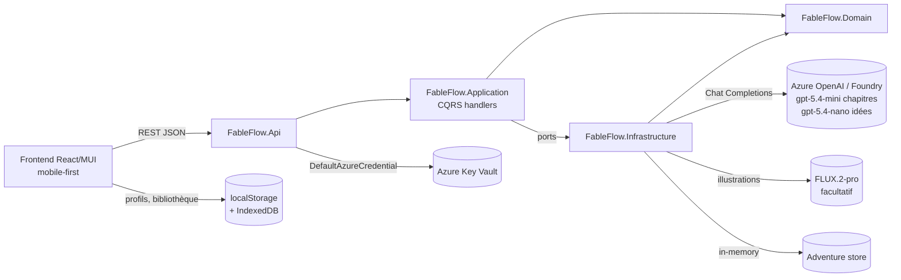
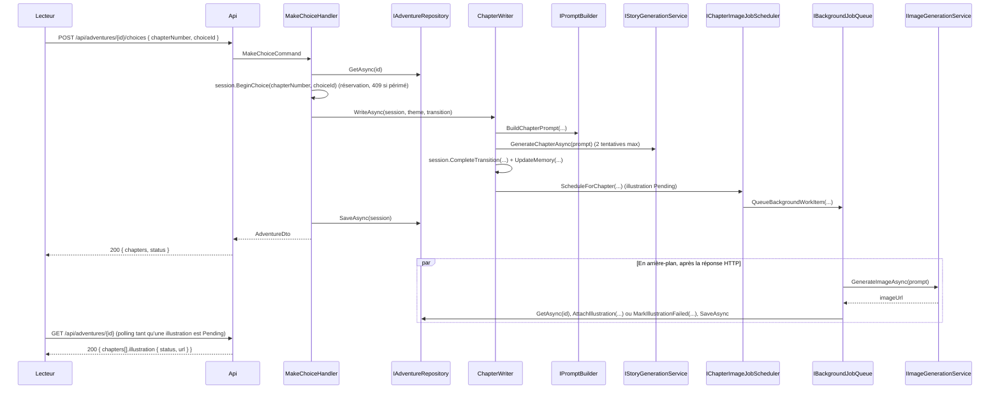

# Architecture — FableFlow

## Vue d'ensemble

FableFlow écrit des **histoires personnalisées, chapitre par chapitre**, adaptées à l'âge du héros et au mode de lecture. Chaque chapitre est généré par un LLM à partir du profil du héros, de l'univers choisi, d'un **plan narratif interne** fixé au premier chapitre et d'une **mémoire narrative** (résumé courant + faits clés), pour garantir la cohérence jusqu'à la conclusion. Il n'y a ni victoire ni défaite : les moments de choix orientent le récit, qui se termine toujours par une conclusion.

## Couches backend

| Couche           | Rôle                                                                                       | Dépendances                     |
| ---------------- | ------------------------------------------------------------------------------------------ | ------------------------------- |
| `Domain`         | Session, chapitres, calendrier, politique de narration par âge, transitions                | Aucune                          |
| `Application`    | CQRS (commands/queries + handlers), `ChapterWriter`, ports, DTOs, validation               | `Domain`                        |
| `Infrastructure` | Impl. des ports : Azure OpenAI, FLUX, prompt builder, repository, thèmes, file de tâches   | `Application`, `Domain`         |
| `Api`            | Endpoints HTTP, DI, config, Key Vault, ProblemDetails, observabilité                       | `Application`, `Infrastructure` |

### Cas d'usage

| Type    | Nom                         | Rôle                                                       |
| ------- | --------------------------- | ---------------------------------------------------------- |
| Command | `StartAdventureCommand`     | Crée la session et écrit le premier chapitre               |
| Command | `AdvanceChapterCommand`     | Passe au chapitre suivant depuis un chapitre de récit      |
| Command | `MakeChoiceCommand`         | Enregistre un choix et écrit la suite                      |
| Query   | `GetAdventureSessionQuery`  | État courant (polling des illustrations)                   |
| Query   | `GetAdventureHistoryQuery`  | Chapitres déjà écrits et choix faits                       |
| Query   | `GetAvailableThemesQuery`   | Univers disponibles                                        |
| Query   | `GetStoryPremisesQuery`     | Idées de départ générées pour un héros et un univers       |

## Parcours de création

1. Le client choisit un profil (héros), un univers, une longueur et un mode de lecture.
2. `POST /api/themes/{themeId}/story-premises` propose plusieurs idées de départ ; le parent peut aussi écrire la sienne.
3. `POST /api/adventures` crée la session et écrit le chapitre 1 (qui fixe aussi le titre et le plan interne).
4. Le lecteur avance (`/advance`) ou choisit (`/choices`) jusqu'au chapitre de conclusion.
5. L'histoire terminée est enregistrée dans la bibliothèque locale du navigateur.

## Flux « faire un choix »

Le texte et les choix sont retournés immédiatement ; l'illustration (plus lente) est planifiée en arrière-plan via `IChapterImageJobScheduler` / `IBackgroundJobQueue` et attachée au chapitre dès qu'elle est prête. Le client la récupère par `GET /api/adventures/{id}` (polling) tant qu'un chapitre est en statut d'illustration `Pending`. `AdvanceChapterCommand` suit le même schéma avec `BeginAdvance`.

En cas d'échec de génération, `ChapterWriter` appelle `AbandonTransition` : le choix n'est **pas** consommé et l'action peut être retentée (502 côté API).

## Modèle de session

- `AdventureSession` (racine d'agrégat) porte un **instantané** du `HeroProfile`, l'univers, le `ReaderMode`, le `ChapterSchedule`, l'idée de départ (`Premise`, 600 caractères max), le titre, le statut (`InProgress` / `Completed`), le résumé courant, les faits clés (12 max) et le plan narratif interne (jamais exposé au client).
- **Calendrier** (`ChapterSchedule`) : `Short` = 6 chapitres, choix aux chapitres 2 et 4 ; `Longer` = 10 chapitres, choix aux chapitres 3, 5 et 8. Le dernier chapitre est toujours la conclusion. Chaque chapitre est `Narrative`, `Decision` ou `Ending`.
- **Transitions** : `BeginOpening` / `BeginAdvance(from)` / `BeginChoice(from, choiceId)` réservent l'écriture du chapitre suivant, puis `CompleteTransition` ou `AbandonTransition`. Une action sur un chapitre périmé, en double ou pendant une écriture en cours lève `StoryConflictException` (409) : le client recharge l'état.
- **Illustrations** : statut par chapitre via `MarkIllustrationPending`, `AttachIllustration`, `MarkIllustrationFailed`.

## Politique de narration

`NarrationPolicy` (Domain) traduit l'âge du héros et le mode de lecture en consignes injectées dans le prompt : nombre de mots par chapitre, longueur des phrases, vocabulaire, structure des phrases et traitement des sujets.

| Âge         | Lu par un adulte (mots/chapitre) | Lu par l'enfant (mots/chapitre) |
| ----------- | -------------------------------- | ------------------------------- |
| 3 à 4 ans   | 70–120                           | 30–60                           |
| 5 à 6 ans   | 110–170                          | 50–90                           |
| 7 à 8 ans   | 170–250                          | 90–150                          |
| 9 à 10 ans  | 240–340                          | 150–230                         |
| 11 à 12 ans | 300–420                          | 200–300                         |

En mode « l'enfant lit » jusqu'à 7 ans, des consignes de lecteur débutant s'ajoutent (mots fréquents à l'orthographe régulière, paragraphes d'une ou deux phrases, répliques clairement attribuées). Les garde-fous enfant (ton sûr, pas de contenu inapproprié, choix non ambigus) s'appliquent au texte comme aux prompts d'illustration. Le prénom de l'enfant n'est jamais transmis au fournisseur d'image : seuls l'âge et l'apparence décrite par le parent le sont.

## Endpoints

| Méthode | Route                                  | Usage                                                     |
| ------- | -------------------------------------- | --------------------------------------------------------- |
| GET     | `/api/themes`                          | Univers disponibles                                       |
| POST    | `/api/themes/{themeId}/story-premises` | Idées de départ `{ length, readerMode, hero, count }`     |
| POST    | `/api/adventures`                      | Démarre une histoire et écrit le chapitre 1 (201)         |
| GET     | `/api/adventures/{id}`                 | État courant                                              |
| POST    | `/api/adventures/{id}/advance`         | Chapitre suivant `{ fromChapterNumber }`                  |
| POST    | `/api/adventures/{id}/choices`         | Choix `{ chapterNumber, choiceId }` puis chapitre suivant |
| GET     | `/api/adventures/{id}/history`         | Chapitres écrits et choix faits                           |

Erreurs en `ProblemDetails` : 400 (validation), 404, **409** (action périmée ou en double : recharger l'état), **502** (génération indisponible : réessayable). Les enums sont sérialisés en chaînes.

## Frontend

| Route              | Page                                                      |
| ------------------ | --------------------------------------------------------- |
| `/`                | Accueil (premier lancement ou reprise : profils, à relire) |
| `/create`          | Création : héros, univers, longueur, idée de départ        |
| `/adventures/:id`  | Lecteur de l'histoire en cours                             |
| `/library`         | Bibliothèque locale                                        |
| `/library/:id`     | Relecture d'une histoire terminée                          |
| `/family`          | Profils de la famille                                      |

- **Données sur l'appareil uniquement**, sans compte ni synchronisation : profils dans `localStorage` (`fableflow:profiles`, versionné), histoires terminées dans IndexedDB (base `fableflow`, magasin `books`), préférence d'aides à la lecture par histoire dans `localStorage` (`fableflow:reading-aids`). Les données lues sont validées et bornées avant usage.
- **Aides à la lecture** (`src/text/syllabify.ts`) : découpage en syllabes **écrites** du français (alternance de couleurs + arc), heuristique proche des manuels de lecture. Les prénoms du héros et des compagnons ne sont jamais découpés, et les mots incertains restent intacts plutôt que mal découpés. Une copie en texte brut, visuellement masquée, est lue par les lecteurs d'écran ; la copie décorée est `aria-hidden`. Les espaces insécables de la ponctuation française sont appliqués au rendu.
- Limites connues : français uniquement ; découpage heuristique (pas de dictionnaire phonétique).

## Évolutions prévues

- Persistance durable (Cosmos DB / Azure SQL) derrière `IAdventureRepository`.
- Synchronisation facultative de la bibliothèque et des profils (compte familial).
- Thèmes stockés côté backend / base de données derrière `IThemePolicyProvider`.
- Filtrage Azure AI Content Safety sur le texte et les illustrations.
- Lecture audio (« lis-moi l'histoire ») via Azure Speech / MAI-Voice.
- Autres fournisseurs LLM / image derrière les ports existants.